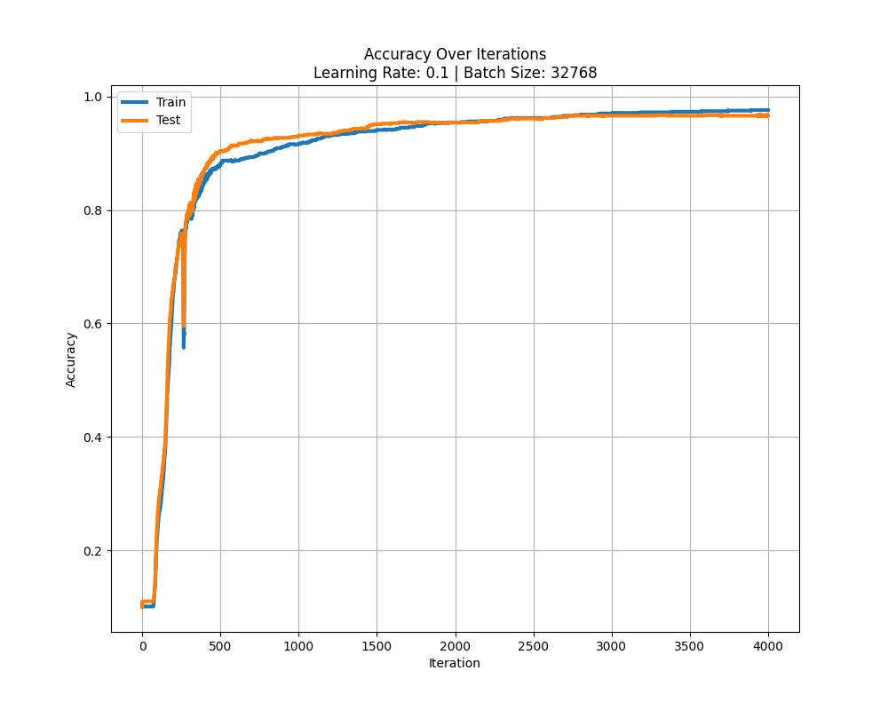

# Neural Network from Scratch: Handwritten Digit Recognition

A fully connected neural network that recognizes handwritten digits (0–9), **built from scratch with NumPy**. No TensorFlow, no PyTorch, no `model.fit()`. Every step is written out by hand: forward propagation, the activation functions and their derivatives, backpropagation with the chain rule, and gradient descent.

It reaches **~97% accuracy on MNIST**, about the same as scikit-learn's `MLPClassifier` with the same architecture. You can also **draw a digit with the mouse** and watch the network guess it.



---

## Quick start

You only need **Python 3** ([download](https://www.python.org/downloads/); on Windows, check *"Add python.exe to PATH"* during setup). The scripts install everything else.

### Windows

1. Double-click **`install.bat`**. It creates a local virtual environment (`.venv`) and installs all the dependencies there. Nothing gets installed system-wide.
2. Double-click **`run.bat`**. It opens `Neural_Network.ipynb` in Jupyter.

### Linux / macOS

```bash
bash install.sh
bash run.sh
```

`run.bat` / `run.sh` will run the installer on their own if you haven't done it yet.

---

## How the network works

### Architecture

```
 Input (784)  ──►  Hidden 1 (256)  ──►  Hidden 2 (128)  ──►  Output (10)
 28x28 pixels        ReLU                 ReLU                 Softmax
```

- **Input:** each 28x28 grayscale image is flattened into 784 values, normalized from `0–255` to `0–1`.
- **Hidden layers:** 256 and 128 neurons with **ReLU**, which keeps gradients large and makes training faster.
- **Output:** 10 neurons with **Softmax**, which turns the outputs into a probability for each digit. The prediction is the digit with the highest probability.

### Forward propagation

$$
\begin{aligned}
Z_1 &= W_1 X + b_1, & A_1 &= \text{ReLU}(Z_1) \\
Z_2 &= W_2 A_1 + b_2, & A_2 &= \text{ReLU}(Z_2) \\
Z_3 &= W_3 A_2 + b_3, & A_3 &= \text{softmax}(Z_3)
\end{aligned}
$$

### Backpropagation

The loss is **cross-entropy**. Using the chain rule, its gradient goes back through the network one layer at a time ($m$ = batch size, $Y$ = one-hot labels):

$$
\begin{aligned}
dZ_3 &= A_3 - Y & dW_3 &= \tfrac{1}{m}\, dZ_3 A_2^{T} & db_3 &= \tfrac{1}{m} \textstyle\sum dZ_3 \\
dZ_2 &= W_3^{T} dZ_3 \odot \text{ReLU}'(Z_2) & dW_2 &= \tfrac{1}{m}\, dZ_2 A_1^{T} & db_2 &= \tfrac{1}{m} \textstyle\sum dZ_2 \\
dZ_1 &= W_2^{T} dZ_2 \odot \text{ReLU}'(Z_1) & dW_1 &= \tfrac{1}{m}\, dZ_1 X^{T} & db_1 &= \tfrac{1}{m} \textstyle\sum dZ_1
\end{aligned}
$$

Then every weight and bias takes a gradient descent step with learning rate $L$: $\;W \leftarrow W - L \cdot dW$.

### Training

- Weights start as small random numbers ($\mathcal{N}(0,1) \cdot 0.01$) so no neuron saturates at the start.
- The data (70,000 MNIST images) is split into **2/3 training and 1/3 test**.
- Each iteration trains on a large batch. Accuracy on train and test is measured along the way and plotted at the end (see [`graphs/`](graphs)).
- The trained weights are saved as `.npz` files in [`Weights_&_Bias/`](Weights_&_Bias), so you can load them later without training again.

---

## Results

Eighteen models were trained with different learning rates, batch sizes and iteration counts. Some were trained further starting from an earlier model. The best ones:

| Model       | Learning rate | Batch size | Iterations                    | Test accuracy | Train accuracy |
| ----------- | ------------- | ---------- | ----------------------------- | ------------- | -------------- |
| `params_17` | 0.1           | 32,768     | 3,000 (on top of `params_16`) | **96.97%**    | 98.91%         |
| `params_16` | 0.1           | 32,768     | 4,000                         | 96.47%        | 97.96%         |
| `params_15` | 0.1           | 16,384     | 4,000                         | ~96%          | ~97%           |
| `params_14` | 0.08          | 8,192      | 4,000                         | 94.06%        | 99.73%         |
| `params_13` | 0.03          | 8,192      | 8,000                         | 93.66%        | 98.77%         |

The full list, with every hyperparameter, is in the comments of `Neural_Network.ipynb`.

**Overfitting:** several models reached 100% on the training set but much less on the test set, which means they memorized the training data instead of learning general patterns. Small batches made this worse, and larger batches with fewer iterations helped. `params_15` is the default for the drawing demo because it generalizes better to new handwriting than the models with higher scores.

**NumPy vs scikit-learn:** an `MLPClassifier` with the same `(256, 128)` layers reached **97.0–97.6%**, almost the same as the hand-written network, but it trained much faster. Writing it by hand gives you full control and shows you exactly what is going on. The library gives you speed.

---

## Notebooks

| Notebook                       | What's inside                                                                                                                                           |
| ------------------------------ | ------------------------------------------------------------------------------------------------------------------------------------------------------- |
| `Neural_Network.ipynb`         | **The main one.** The NumPy network: training, accuracy plots, the draw-a-digit demo, prediction on the sample images in `digits/`, and evaluation. |
| `Tests_ARFF_&_Resources.ipynb` | The same task with scikit-learn's `MLPClassifier` on MNIST (downloaded from OpenML), plus notes and links used during the project.                       |
| `Tests_CSV.ipynb`              | `MLPClassifier` trained on the Kaggle MNIST CSV (`DATA/train.csv`).                                                                                      |
| `test_emnist_digits.ipynb`     | `MLPClassifier` on EMNIST Digits (a larger digit dataset).                                                                                              |
| `test_emnist_balanced.ipynb`   | `MLPClassifier` on EMNIST Balanced: 47 classes (digits **and letters**), ~84% accuracy.                                                                 |
| `Extra.ipynb`                  | Dataset exploration and visualizations.                                                                                                                 |

### Using `Neural_Network.ipynb`

1. **Train:** asks whether to **load** saved weights (`c`) or **train from scratch** (`e`), and at the end whether to save the result (`y`/`n`). Pick the weights file with the `model_params_file` line. Full training takes around 20–30 minutes on a regular CPU.
2. **Plot:** draws the accuracy curve and saves it to `graphs/`.
3. **Draw a digit:** opens a window. Draw with the mouse, press **Enter** to predict, or **Esc** to clear.
4. **Sample images:** predicts the 10 handwritten digits in `digits/`.
5. **Evaluate:** measures a saved model on a whole dataset.
6. **Dataset preview:** shows the first 50 MNIST images with their labels.

The first time, MNIST is downloaded from OpenML (about 15 MB) and cached.

---

## Project structure

```
├── Neural_Network.ipynb    # Main notebook (NumPy network)
├── *.ipynb                 # scikit-learn comparisons and experiments
├── Weights_&_Bias/         # Trained models (params_0.npz … params_17.npz)
├── graphs/                 # Accuracy plots for each training run
├── digits/                 # Hand-drawn digits for testing
├── DATA/                   # MNIST / EMNIST datasets (CSV)
├── requirements.txt        # Dependencies
├── install.bat / .sh       # Creates .venv and installs dependencies
└── run.bat / .sh           # Opens the main notebook
```

The full write-up (in Spanish), with the math derivations and the analysis, is in `Proyecto Final - Matemática III.pdf`.
